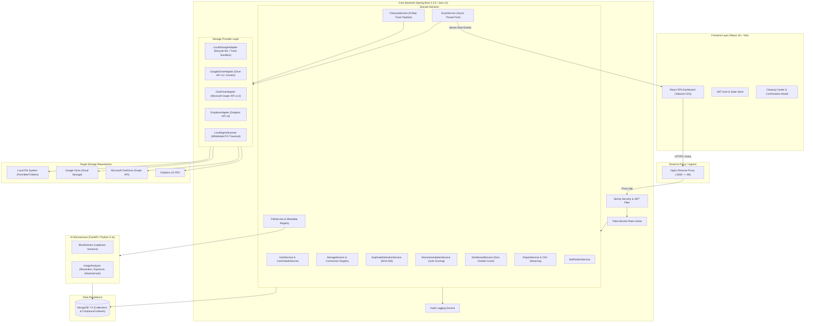

# CloudClean AI – System Architecture Documentation

CloudClean AI is a microservice-augmented modular monolith designed for intelligent, enterprise-grade cloud and local storage optimization. The architecture prioritizes data safety, tenant isolation, zero double-counting in storage diagnostics, and multi-signal AI analysis.

---

## 1. High-Level Architecture Diagram

---

## 2. Inter-Service Communication Flow

### A. Scanning & Detection Pipeline
1. **Trigger Scan**: User requests a scan on a configured target (`Local Computer`, `Google Drive`, `Microsoft OneDrive`, or `Dropbox`).
2. **Asynchronous Execution & SSE**: `ScanService` enqueues a `ScanJob` (`@Async` thread pool), returning `202 Accepted` with a `scanId`. The client connects to `GET /api/scans/{id}/progress/stream` (Server-Sent Events) to observe real-time progress across 7 distinct scanning phases.
3. **Provider Traversal**:
   - For **Local Storage**: `LocalAgentScanner` traverses only user-approved directories. Restricted paths (`C:\Windows`, `/etc`, etc.) and directory traversals (`..`) are blocked. SHA-256 checksums are calculated streamingly.
   - For **Google Drive**: `GoogleDriveAdapter` fetches file metadata via Google Drive API v3 using user OAuth access tokens (auto-refreshed via encrypted refresh tokens).
   - For **Microsoft OneDrive**: `OneDriveAdapter` navigates folder trees recursively using Microsoft Graph API v1.0 (`/me/drive/root/children` with `@odata.nextLink` pagination) and resolves items streaming.
   - For **Dropbox**: `DropboxAdapter` leverages Dropbox API v2 `/2/files/list_folder` cursor-based pagination and streaming downloads via `content.dropboxapi.com`.
4. **AI Image Analysis**:
   - Image files are submitted via internal HTTP to the **FastAPI AI Microservice** (`/analyze/full`).
   - The microservice executes OpenCV Laplacian variance, calculates perceptual difference hashes (`dHash`, `ahash`), and detects under/overexposure without storing raw images.
5. **Deduplication & Junk Scoring**:
   - `DuplicateDetectionService` clusters files by exact SHA-256 and size matching.
   - `RecommendationService` applies multi-signal weights (`junkScore` 0–100) and risk levels (`LOW`, `MEDIUM`, `HIGH`).
6. **Notification**: `NotificationService` emits an in-app alert upon scan completion.

### B. Safe Cleanup & Recovery Pipeline
1. **Candidate Selection**: User selects candidate files in `CleanupRecommendations.jsx`.
2. **Duplicate Safety Net**: The backend analyzes selected duplicate files against their duplicate groups (`duplicate_groups` collection). If all copies of a duplicate cluster are targeted for deletion, the safety net automatically preserves the primary original master copy (`Keep Original`), preventing accidental permanent loss of all file copies.
3. **Impact Calculation**: Backend calculates exact recoverable space via `/api/cleanup/impact`, filtering out protected whitelisted files.
4. **Explicit Confirmation**: The user must check the explicit confirmation checkbox (`confirmed: true`); unconfirmed requests fail with `400 Bad Request`.
5. **Provider-Safe Multi-Cloud Trash**:
   - **Local Storage**: Files are relocated to the local `.cloudclean_trash` directory sandbox.
   - **Google Drive**: Files are moved to Google Drive trash via `trashed: true`.
   - **Microsoft OneDrive**: Files are sent to the user's OneDrive Recycle Bin via Microsoft Graph `DELETE /me/drive/items/{id}` (restorable for 30–93 days).
   - **Dropbox**: Files are moved to Dropbox retention trash via `/2/files/delete_v2` (restorable for 30–180 days).
6. **Reconciliation & Audit**:
   - Storage reclaimed is only recorded once confirmed by the provider adapter.
   - Detailed snapshot is saved to `cleanup_history`.
   - Restoration is available anytime via `/api/cleanup/{id}/restore`.

---

## 3. Database Design & MongoDB Collections (All 12 Collections)

All entities reside in the `cloudclean` database with index optimizations, tenant isolation, and audit timestamps:

### 1. `users`
- Stores user credentials, registration timestamps, and role claims.
- **Fields**: `id`, `fullName`, `email`, `password` (BCrypt hashed), `role`, `userPreferencesId`, `createdAt`, `updatedAt`.
- **Indexes**:
  - `email` (Unique)
  - `createdAt`

### 2. `storage_connections`
- Monitored drive configurations and OAuth credentials.
- **Fields**: `id`, `userId`, `provider` (`LOCAL`, `GOOGLE_DRIVE`), `accountIdentifier`, `encryptedAccessToken`, `encryptedRefreshToken`, `monitoredPaths`, `connectionStatus`, `tokenExpiry`, `connectedAt`.
- **Indexes**:
  - Compound: `{ userId: 1, provider: 1 }`

### 3. `local_devices`
- Registered agent workstations, approved folders, and heartbeat sync telemetry.
- **Fields**: `id`, `userId`, `deviceName`, `osName`, `hostname`, `agentVersion`, `approvedFolders`, `status` (`ONLINE`, `OFFLINE`, `SCANNING`), `lastHeartbeat`, `lastScanTime`, `registeredAt`.
- **Indexes**:
  - Compound: `{ userId: 1, hostname: 1 }`
  - Single: `lastHeartbeat`

### 4. `files`
- Comprehensive file catalog across all storage sources with deduplication metadata.
- **Fields**: `id`, `userId`, `storageLocation`, `storageProvider`, `storageType`, `providerFileId`, `fileName`, `fileExtension`, `fileSize`, `mimeType`, `folderPath`, `sha256Hash`, `isDuplicate`, `isProtected`, `isExcluded`, `isTrashed`, `isDeleted`, `originalFileId`, `lastModified`, `createdAt`, `updatedAt`.
- **Indexes**:
  - Compound: `{ userId: 1, sha256Hash: 1 }`
  - Compound: `{ userId: 1, isDuplicate: 1 }`
  - Compound: `{ userId: 1, isProtected: 1 }`
  - Compound: `{ userId: 1, storageLocation: 1 }`
  - Compound: `{ userId: 1, providerFileId: 1 }`

### 5. `scan_jobs`
- Real-time and historical scan execution telemetry and metrics.
- **Fields**: `id`, `userId`, `targetStorage`, `targetPath`, `status` (`PENDING`, `IN_PROGRESS`, `COMPLETED`, `FAILED`, `CANCELLED`), `filesScanned`, `bytesScanned`, `duplicatesFound`, `blurryImagesFound`, `inactiveFilesFound`, `largeFilesFound`, `startedAt`, `completedAt`, `createdAt`.
- **Indexes**:
  - Compound: `{ userId: 1, createdAt: -1 }`

### 6. `duplicate_groups`
- Exact cryptographic hash collision clusters.
- **Fields**: `id`, `userId`, `sha256Hash`, `fileSize`, `originalFileId`, `duplicateFileIds`, `potentialSavingsBytes`, `createdAt`.
- **Indexes**:
  - Compound: `{ userId: 1, sha256Hash: 1 }`

### 7. `file_analyses`
- AI computer-vision and heuristic image telemetry.
- **Fields**: `id`, `fileId`, `userId`, `laplacianVariance`, `blurScore`, `isBlurry`, `dhash`, `exposureStatus`, `qualityScore`, `imageResolution`, `imageQuality`, `isDuplicate`, `isInactive`, `detectionReasons`, `analysisTimestamp`, `createdAt`.
- **Indexes**:
  - Single: `fileId` (Unique)
  - Compound: `{ userId: 1, isBlurry: 1 }`
  - Compound: `{ userId: 1, createdAt: -1 }`

### 8. `recommendations`
- Smart optimization recipes with user-decision tracking.
- **Fields**: `id`, `userId`, `fileId`, `fileName`, `fileType`, `fileSize`, `storageSource`, `junkScore`, `detectionReasons`, `recommendedAction`, `riskLevel`, `analysisDate`, `status` (`ACTIVE`, `ACCEPTED`, `REJECTED`, `EXCLUDED`, `PROTECTED`), `userDecision`, `createdAt`.
- **Indexes**:
  - Compound: `{ userId: 1, status: 1, riskLevel: 1 }`
  - Compound: `{ userId: 1, fileId: 1 }`

### 9. `cleanup_history`
- Audited record of disk alterations with rollback tracking.
- **Fields**: `id`, `userId`, `filesCleanedCount`, `failedCount`, `bytesRecovered`, `storageSource`, `storageProvider`, `originalLocationReference`, `recoveryStatus`, `errorInformation`, `cleanedFileSnapshots`, `isRestored`, `restorationSupported`, `createdAt`.
- **Indexes**:
  - Compound: `{ userId: 1, createdAt: -1 }`

### 10. `notifications`
- In-app notification queue for asynchronous events.
- **Fields**: `id`, `userId`, `title`, `message`, `type` (`INFO`, `SUCCESS`, `WARNING`, `ERROR`), `isRead`, `actionLink`, `createdAt`.
- **Indexes**:
  - Compound: `{ userId: 1, isRead: 1, createdAt: -1 }`

### 11. `user_preferences`
- User-specific scanning thresholds, alerts, and personalization.
- **Fields**: `id`, `userId`, `autoScanFrequency` (`DAILY`, `WEEKLY`, `MONTHLY`, `OFF`), `inactivityDaysThreshold`, `largeFileThresholdMb`, `blurVarianceThreshold`, `protectedExtensions`, `emailAlertsEnabled`, `inAppAlertsEnabled`, `theme`, `updatedAt`.
- **Indexes**:
  - Single: `userId` (Unique)

### 12. `audit_logs`
- Security and compliance event tracking.
- **Fields**: `id`, `userId`, `eventType`, `details`, `clientIp`, `status`, `timestamp`.
- **Indexes**:
  - Compound: `{ userId: 1, eventType: 1, timestamp: -1 }`

---

## 4. API & Security Architecture

- **Stateless Authentication**: All requests require an `Authorization: Bearer <JWT>` header, verified against HMAC SHA-256 signature and expiration.
- **User Tenant Isolation**: Every controller resolves `userId` from the verified token principal. Repositories enforce ownership filtering at query time.
- **Zero Double-Counting Storage Engine**: `DashboardService` calculates recoverable bytes using distinct file identifier sets, guaranteeing that files matching multiple signals (e.g. duplicate + inactive) are only counted once.
- **Rate Limiting**: Critical endpoints (`/api/scans`, `/api/cleanup`) are shielded by an in-memory token-bucket rate limiter.
- **Encryption at Rest**: Google Drive OAuth refresh tokens are encrypted using AES-256 GCM with unique 12-byte initialization vectors (`IV`) before persistence.
